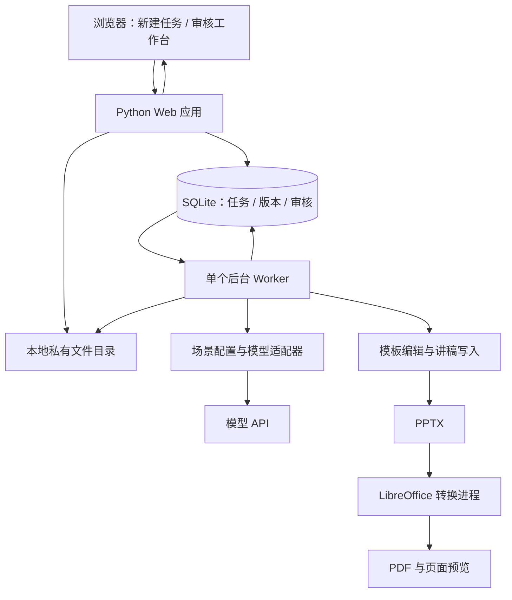

# Nero PPT 轻量架构方案

日期：2026-11-13。状态：建议方案；仅设计，无应用代码。

## 本轮评审后的设计约束

结合 DeepSeek 建议，新增 SourceBlock/Fact → SlideSpec → TemplateProfile/版式绑定 → RenderPlan → QAReport 的显式数据链路。模型不生成坐标或执行代码；逐页内容生成必须获得模板槽位预算。用户模板优先保留原页面，内置模板只做受限布局计算。自动修复初始上限为每页 2 轮，失败或影响已批准内容时交还用户审核。详细取舍见 [建议评审](2026-11-13-deepseek-review.md)。

compono、sayou-document、Docling 等均为待验证候选，不是已确定运行依赖；首版不增加多 Agent 或通用布局 DSL。

## 1. 方案比较

| 方案 | 优点 | 取舍 |
| --- | --- | --- |
| Skill + 脚本 | 最少界面工作，便于内部验证 | 客户需要使用宿主工具，不符合独立网页入口 |
| Streamlit 类快速界面 | 原型页面工作较少 | 复杂的版本审核交互需要额外组织状态 |
| 简单网页 + Python 单体（推荐） | 保持独立网页体验，可精确控制审核与文件下载 | 比纯脚本多一层 Web 接口，但不需要平台架构 |

推荐 FastAPI + Jinja2 模板页面 + 少量 JavaScript。后端直接提供网页与 API，不拆独立前端工程。页面轮询任务状态即可，首版不引入 WebSocket、前端状态管理框架或微服务。

FastAPI 官方提供模板页面支持；参考资料见文末。具体依赖版本在实现时确认与锁定。

## 2. 运行结构



一台机器、同一代码库、Web 与 Worker 两个进程、一个 SQLite 文件、一份文件存储目录。Worker 串行处理生成步骤，网页请求只提交任务或审核动作，不等待整份 PPT 生成。不是两个独立微服务。

SQLite 用于低并发单机状态存储；短事务写入、必要的锁等待和任务领取原子操作需要在实现时验证。文件数据不写入数据库。以后出现吞吐瓶颈再替换存储或调度。

## 3. 模块职责

| 模块 | 输入 | 输出 |
| --- | --- | --- |
| 资料解析 | 文档 | 结构化文本、表格、来源位置 |
| 场景路由 | 用户选择与要求 | 场景配置和需求摘要 |
| 内容规划 | 资料、场景 | 逐页大纲和 SlideSpec |
| 模板适配 | PPTX/POTX | 版式档案、可编辑区域、兼容性问题 |
| 页面生成 | SlideSpec、模板档案 | PPTX 页面及 Notes |
| 渲染检查 | PPTX | PDF、缩略图、问题清单 |
| 流程控制 | 审核动作、当前版本 | 下一步骤、暂停或修改任务 |

模型负责语义工作：理解资料、组织逻辑、改写、讲稿和修改意见解析。程序负责权限、状态转换、模板复制、文件写入和版本检查。模型不直接决定批准状态，不执行资料中携带的指令，也不生成任意脚本在服务器运行。

## 4. 简单状态机，不引入 Agent 编排框架

```text
uploaded → outlining → outline_review
→ sampling → sample_review
→ batch_generating → batch_review（按批次循环）
→ assembling → final_review → completed
```

failed、cancelled 是异常状态，running 步骤保存检查点。每个任务记录 current_step、input_revision、approved_revision、batch_index、status、error。

每次生成都保存输入快照与输出版本。审核请求携带 expected_revision，版本已变化则提示刷新。修改生成新修订；全局变更使旧后续产物失效，并退回大纲或样张审核。任务完成时检查输入修订，过期任务不可发布当前结果。

后台重启时，将遗留 running 步骤标记 interrupted，提供从最近成功检查点重试。首版不承诺模型调用精确一次：异常重试可能重复消耗模型费用，但不能重复发布产物。用户等待审核时不占用 Worker。

## 5. 数据结构

SQLite 初期只需以下逻辑对象，可在实现时按需合表：

- user/access：独立访问凭据的哈希与用户标识，无组织模型。
- job：归属用户、要求、场景、模板、当前阶段和当前修订。
- revision：版本号、需求/大纲/SlideSpec JSON、输入版本。
- step：待执行步骤、状态、错误与已成功检查点。
- artifact：相对文件路径、类别、版本、文件哈希。
- review：审核对象版本、决定、修改意见和时间。

SlideSpec 的最小字段为 slide_id、title、key_message、layout_id、content、source_refs、speaker_notes、target_seconds。页序单独保存，不把页码当作页面身份。

每个任务一个私有目录：

```text
data/jobs/<job-id>/
  inputs/                  # 原始资料与模板
  parsed/                  # 提取内容与来源
  revisions/<revision>/    # 大纲、逐页规格和生成文件
  previews/<revision>/     # PDF 与缩略图
  exports/<revision>/      # 同一版本的最终三份交付物
```

下载由应用按归属鉴权后返回，data 不能作为公共静态目录。日志避免输出全文资料和模型密钥。

## 6. 文档技术路径

推荐 Python 为主，python-pptx 用于受支持对象的读写和 Notes；模板页面复用及复杂资源关系通过受控 OOXML 操作处理。官方文档支持 Notes 文本读写，但不能由此推断任意模板都可无损编辑。

内置模板与用户模板走同一路径，避免首版同时维护两套 PPT 引擎。模板图表仅处理已适配类型；缺少支持时停止并说明，不擅自截图替换可编辑对象。

LibreOffice 作为首版 PDF 转换候选。每次转换独立临时目录和用户配置，设置超时与资源限制；渲染环境提供中文字体。输出 PDF 再生成缩略图，并检查边界、重叠和占位符。最终仍需用目标演示软件验收。

## 7. 模型调用与资料规模

只接一个模型供应商，封装 generate_outline、generate_slides、revise_slide 三类能力；同一个模型可承担不同步骤，不必拆多个 Agent。模型输出通过结构校验后进入下一阶段。

短资料直接传入；长资料按章节提取事实和引用，再选择相关片段生成对应章节。不一次性盲目截断原文，也不预先引入向量数据库。遇到内容覆盖不足时要求补充或调整范围。

## 8. 轻量部署与边界

建议一个部署单元管理 Web 与 Worker，持久化挂载 SQLite 和 data 目录，模型密钥使用服务端环境配置。在线提供独立用户凭据与 HTTPS；单机本地测试可省去公开访问入口。暂不做账户注册、找回、支付或复杂 RBAC。

上传限制类型、大小、解压比例和页数；拒绝宏执行，解析与转换任务使用受限进程。失败时保留可读错误及成功检查点，不能展示虚假进度或完成状态。

## 9. 应验证的关键风险

最先验证模板保留效果与字体兼容，其次是中文长文本、图表资源关系、Notes 和 PDF 一致性。状态机验证审核暂停、过期批准、局部修改、重启恢复及任务文件归属。无需为暂未实现的平台能力建立复杂测试体系。

## 10. 官方资料索引

- FastAPI 官方文档：Templates（Jinja2Templates）。
- FastAPI 官方文档：Background Tasks / Caveat（重计算任务的进程边界）。
- python-pptx 官方文档：Introduction、Working with Notes Slides。
- LibreOffice Help：PDF CLI Parameters。

资料用于确认基础能力；所选具体模板与运行环境的兼容性必须另外验证。
